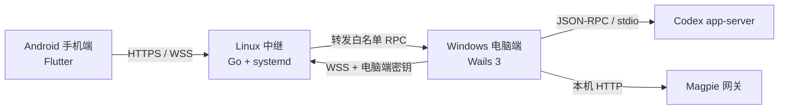

# CodexLink

[](https://github.com/shuaigehuang/codexlink/actions/workflows/ci.yml)
[](LICENSE)

用手机远程连接自己电脑上的 **Codex**，并通过 **Magpie** 管理模型路由和网关密钥。

CodexLink 由三部分组成：Windows 电脑端、Android 手机端，以及部署在自己服务器上的轻量中继。手机不直接暴露电脑端口，所有远程请求都经过中继转发，电脑端负责真正执行。

> **安全提示**：请优先使用已备案域名 + HTTPS。项目保留 HTTP 明文模式用于临时测试，但明文模式下电脑端密钥、对话内容、远程指令和 Magpie 管理结果都可能被公网中间人截获。详见 [安全模型](docs/step-05-security-and-keys.md)。

## 功能

- **远程下达指令**：手机可以在电脑已有会话中继续对话；电脑正在执行任务时，指令会排队并使用同一会话继续，不会另开新会话或中断当前任务。
- **查看历史会话**：读取电脑上 Codex 的真实会话、轮次、消息和命令记录。
- **Magpie 管理**：查看 Provider、余额、网关密钥，创建/轮换/启停/删除密钥。
- **一次性扫码配对**：电脑端生成 8 位配对码和二维码，10 分钟内有效且只能领取一次。
- **手机令牌管理**：电脑端可查看在线状态、授权时间、到期时间，并单个或全部撤销。
- **服务器管理后台**：在服务器网页中增删电脑端接入令牌、查看在线设备与可用连接地址。
- **自动重连**：电脑端关闭窗口后默认隐藏到系统托盘，保持与中继的连接。
- **本地密钥保护**：电脑端配置使用 Windows DPAPI 加密；手机令牌保存在系统安全存储。
- **命令输出折叠**：手机端默认折叠长命令输出，只显示可展开的命令摘要。
- **快速回到底部**：长会话新增“回到底部”按钮，打开会话自动定位到最新消息。

## 架构



中继只负责鉴权、配对和请求转发，不保存 Codex 对话内容，也不能主动向电脑下发命令。电脑端始终是执行边界。

## 快速开始

### 1. 部署中继

准备一台 Linux 服务器和已解析到服务器的域名：

```bash
tar -xzf codexlink-relay-linux-amd64.tar.gz
cd codexlink-relay-linux-amd64
sudo bash ./install.sh --domain relay.example.com --email you@example.com
```

安装完成后保存终端输出的**中继地址**和**电脑端密钥**。密钥只显示一次。
安装脚本还会生成服务器管理密码，保存在 `/etc/codexlink-relay.env`；打开
`https://relay.example.com/admin` 即可进入管理后台。

没有域名时可以临时使用公网 IP：

```bash
sudo bash ./install.sh --http-public YOUR_SERVER_IP
```

该模式使用明文 HTTP/WS，仅建议临时测试。正式使用请改用 `--domain` 启用自动 HTTPS。

如果暂时不申请 SSL 证书，但需要同时开放 80 和 443：

```bash
sudo bash ./install.sh --http-dual YOUR_SERVER_IP
```

该模式下 `http://YOUR_SERVER_IP` 和 `http://YOUR_SERVER_IP:443` 都是明文 HTTP，
`443` **不是 HTTPS**。管理密码、电脑端令牌和对话内容都可能被中间人截获，仅适合临时使用。

### 2. 启动电脑端

1. 安装并启动 Codex 桌面版。
2. 启动 Magpie，确认 `magpie.com` 可在本机运行。
3. 打开 CodexLink，进入“设备配对”，填写中继地址和电脑端密钥。
4. 连接成功后点击“生成配对码”。

电脑端会自动查找 Codex：

```text
%LOCALAPPDATA%\OpenAI\Codex\bin\*\codex.exe
```

仍无法识别时，设置环境变量 `CODEX_CLI_PATH` 指向实际的 `codex.exe`，然后重启 CodexLink。

### 3. 配对手机

1. 安装 `codexlink-mobile.apk`。
2. 打开 App，扫描电脑端二维码；也可以手动填写中继地址和 8 位配对码。
3. 配对成功后即可查看会话、发送指令和管理 Magpie。

手机令牌默认 90 天有效。电脑端“已授权手机”面板可以随时撤销单台或全部手机。

## 下载

构建产物发布在 [GitHub Releases](https://github.com/shuaigehuang/codexlink/releases)：

| 文件 | 说明 |
| --- | --- |
| `CodexLink.exe` | Windows 10/11 电脑端 |
| `codexlink-mobile.apk` | Android 手机端 |
| `codexlink-relay-linux-amd64.tar.gz` | x86_64 Linux 中继安装包 |
| `codexlink-relay-linux-arm64.tar.gz` | ARM64 Linux 中继安装包 |
| `SHA256SUMS.txt` | 发布文件校验值 |

仓库不提交二进制文件。源码构建方式见下一节。

## 从源码构建

### 环境要求

| 组件 | 版本 |
| --- | --- |
| Go | 1.27+ |
| Node.js | 22+ |
| Flutter | 支持 Dart 3.14+ 的稳定版 |
| Android SDK | API 35+，含 Build Tools 和 CMake |
| Wails 3 | 3.1+ |
| Linux 中继 | systemd、curl，可选域名和 80/443 端口 |

### 电脑端

```powershell
go install github.com/wailsapp/wails/v3/cmd/wails3@latest
cd apps/desktop/CodexLink
wails3 build
```

产物位于 `apps/desktop/CodexLink/bin/`。

只构建前端：

```powershell
cd apps/desktop/CodexLink/frontend
npm ci
npm run build
```

修改 Go 服务方法后重新生成前端绑定：

```powershell
cd apps/desktop/CodexLink
wails3 task common:generate:bindings
```

### 手机端

```bash
cd apps/mobile
flutter pub get
flutter analyze
flutter test
flutter build apk --release
```

产物位于 `apps/mobile/build/app/outputs/flutter-apk/app-release.apk`。

### 中继

```powershell
pwsh ./deploy/build-package.ps1 -Arch all
```

脚本在 `dist/` 下生成 amd64/arm64 安装包和 SHA256 校验文件。

## 中继配置

中继通过环境变量配置。`deploy/install.sh` 会自动生成 `/etc/codexlink-relay.env`（权限 `0600`）。

| 变量 | 默认值 | 说明 |
| --- | --- | --- |
| `CODEXLINK_RELAY_DESKTOP_TOKEN` | 无 | 电脑端密钥，至少 32 字符，必填 |
| `CODEXLINK_RELAY_ADMIN_TOKEN` | 空 | 服务器管理后台密码，至少 32 字符；为空时关闭管理后台 |
| `CODEXLINK_RELAY_PUBLIC_URLS` | 空 | 管理后台展示的公开地址，逗号分隔 |
| `CODEXLINK_RELAY_DATA_DIR` | `./data` | 会话和证书缓存目录 |
| `CODEXLINK_RELAY_LISTEN` | `127.0.0.1:8787` | 监听地址 |
| `CODEXLINK_RELAY_EXTRA_HTTP_ADDR` | 空 | 额外明文 HTTP 监听地址，例如 `:443` |
| `CODEXLINK_RELAY_PAIR_TTL` | `10m` | 配对码有效期 |
| `CODEXLINK_RELAY_SESSION_TTL` | `2160h` | 手机令牌有效期，默认 90 天 |
| `CODEXLINK_RELAY_TRUST_PROXY` | `false` | 是否信任 `X-Forwarded-For` |
| `CODEXLINK_RELAY_ORIGINS` | 空 | 允许的 WebSocket Origin，逗号分隔 |
| `CODEXLINK_RELAY_TLS_DOMAIN` | 空 | 启用自动 HTTPS 的域名 |
| `CODEXLINK_RELAY_TLS_EMAIL` | 空 | Let's Encrypt 通知邮箱 |
| `CODEXLINK_RELAY_HTTP_ADDR` | `:80` | HTTP 跳转/ACME 监听地址 |

安装模式：

```bash
# 自动 HTTPS，推荐
sudo bash ./install.sh --domain relay.example.com --email you@example.com

# 公网 IP 明文 HTTP，仅测试
sudo bash ./install.sh --http-public YOUR_SERVER_IP

# 80 和 443 都提供明文 HTTP，不申请 SSL 证书
sudo bash ./install.sh --http-dual YOUR_SERVER_IP

# 只监听 127.0.0.1:8787，交给 Nginx/Caddy 反代
sudo bash ./install.sh --http-only
```

## 服务器管理后台

安装时脚本会生成独立的管理密码。打开：

```text
https://relay.example.com/admin
```

后台支持：

- 查看中继是否在线、当前在线电脑端和手机数量。
- 查看并复制可用的服务器连接地址，以及每个地址是否加密。
- 生成新的电脑端接入令牌。完整令牌只显示一次，服务器只保存哈希。
- 删除电脑端令牌。删除在线令牌会立即断开对应电脑端，至少保留一个令牌防止失联。

管理后台管理的是**电脑端接入令牌**；手机授权令牌仍由电脑端“已授权手机”面板管理。
管理会话默认 12 小时有效，并带有 CSRF 防护和登录失败限速。

服务管理：

```bash
systemctl status codexlink-relay
journalctl -u codexlink-relay -f
curl https://relay.example.com/healthz
```

## 协议与安全边界

中继暴露以下端点：

| 端点 | 用途 |
| --- | --- |
| `GET /healthz` | 健康检查 |
| `GET /v1/desktop/connect` | 电脑端 WebSocket 长连接 |
| `GET /v1/desktop/sessions` | 列出当前电脑的手机授权 |
| `POST /v1/desktop/sessions/revoke` | 撤销单台或全部手机授权 |
| `POST /v1/pair/claim` | 手机领取一次性配对码 |
| `GET /v1/mobile/connect` | 手机 WebSocket RPC 通道 |
| `POST /v1/mobile/rpc` | 手机 HTTP RPC 通道 |
| `GET /admin` | 服务器管理后台登录页 |
| `POST /admin/login` | 管理员登录 |
| `GET /admin/api/state` | 令牌、在线设备和公开地址状态 |
| `POST /admin/api/tokens` | 生成电脑端令牌 |
| `DELETE /admin/api/tokens/{id}` | 删除电脑端令牌 |

手机只能调用中继白名单中的方法，包括 `ping`、`node.status`、`threads.list`、`threads.read`、`threads.send`、`magpie.status` 和 Magpie 管理方法。

- 中继只持久化手机令牌的 SHA-256 哈希，不保存令牌原文。
- 电脑端令牌只保存 SHA-256 哈希，完整值仅在创建时显示一次。
- 电脑端密钥只保存在电脑本地，使用 Windows DPAPI 加密。
- 手机令牌只保存在 Android 安全存储。
- Magpie Provider Key 和网关密钥不会写入日志；完整密钥只在创建或轮换时返回一次。
- HTTP 模式不具备机密性和完整性保护，请勿在公共 Wi-Fi 下使用。
- `--http-dual` 的 443 端口仍是 HTTP 明文，不是 HTTPS；不要因为端口号是 443 就认为连接已加密。

漏洞报告方式见 [SECURITY.md](SECURITY.md)。请不要在公开 Issue 中粘贴密钥、令牌、服务器地址或完整日志。

## 目录结构

```text
apps/desktop/CodexLink   Wails 3 电脑端
apps/mobile              Flutter Android 手机端
internal/codex           Codex app-server 客户端
internal/magpie          Magpie CLI / 管理 API 客户端
internal/relay           中继协议、会话存储和 HTTP/WS 服务
internal/dpapi           Windows DPAPI 封装
cmd/codexlink-relay      中继入口
cmd/codexlink-probe      本机只读探测工具
deploy                   Linux 安装包与 systemd 部署
docs                     设计与安全说明
tools                    开发和协议探测工具
```

## 常见问题

### 电脑端显示 Codex 不可用

确认 Codex 桌面版已经启动，并检查“设置”页显示的实际路径。也可以设置 `CODEX_CLI_PATH` 后重启 CodexLink。

### 手机一直显示连接中

依次检查：

1. 电脑端“设备配对”页是否显示中继已连接。
2. 手机填写的中继地址是否与电脑端完全一致。
3. 服务器安全组是否放行 80/443，系统防火墙是否放行对应端口。
4. HTTPS 证书是否有效；HTTP 模式是否被网络环境拦截。
5. 中继日志：`journalctl -u codexlink-relay -f`。

### 手机发送指令提示“已有写入者”

Codex 同一会话只允许一个写入者。电脑端正在回复该会话时，手机会自动重试，不会新建会话。等待电脑完成当前回复，或在电脑上切换到其他会话后重试。

### 关闭电脑端窗口后手机断开

在“设置”中开启“关闭窗口后继续后台运行”。彻底退出请使用系统托盘菜单中的“退出并断开”。

## 开发与测试

```bash
go test ./... -count=1
go vet ./...
cd apps/desktop/CodexLink && go test ./... -count=1 && go vet ./...
cd apps/desktop/CodexLink/frontend && npm ci && npm run build
cd apps/mobile && flutter analyze && flutter test
```

CI 会执行相同的构建和测试。协议验证记录见 `docs/step-01` 至 `docs/step-06`。

## 贡献

欢迎提交 Issue 和 Pull Request。开始前请阅读 [CONTRIBUTING.md](CONTRIBUTING.md) 和 [CODE_OF_CONDUCT.md](CODE_OF_CONDUCT.md)。

## 许可证

[MIT](LICENSE)

CodexLink 与 OpenAI、Codex、Magpie 项目没有官方隶属关系。使用本项目产生的费用、数据和安全风险由使用者自行承担。
